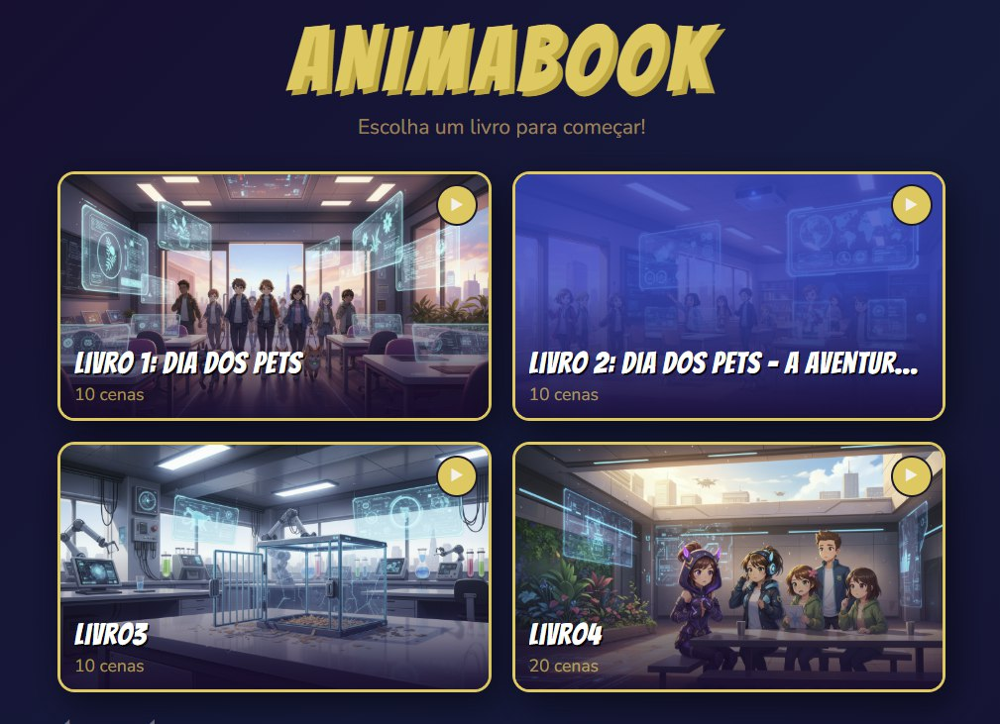

# Animabook

[](https://animabook.vercel.app)

**[animabook.vercel.app](https://animabook.vercel.app)**

Plataforma web mobile-first para criar, publicar e interagir com histêƒÂ³rias em quadrinhos animadas. Qualquer pessoa lêƒÂª os livros; usuêƒÂ¡rios logados escrevem seu prêƒÂ³prio rascunho e publicam versêƒÂµes autorais que outros podem curtir e comentar.

---

## Funcionalidades

- **Reader animado** ê¢â‚¬â€ balêƒÂµes de fala com spring animation, narrador com efeito typewriter, transiêƒÂ§êƒÂµes entre cenas, swipe para navegar
- **Sidebar de publicaêƒÂ§êƒÂµes** ê¢â‚¬â€ painel lateral na pêƒÂ¡gina do livro lista todas as versêƒÂµes publicadas; ao selecionar, a histêƒÂ³ria e o painel social carregam inline
- **Editor por usuêƒÂ¡rio** ê¢â‚¬â€ cada usuêƒÂ¡rio tem seu prêƒÂ³prio rascunho por livro; salvo no Supabase com Ctrl+S
- **BalêƒÂµes arrastêƒÂ¡veis** ê¢â‚¬â€ posicione cada balêƒÂ£o livremente sobre a imagem
- **PublicaêƒÂ§êƒÂµes** ê¢â‚¬â€ botêƒÂ£o "Publicar ê°Å¸Å¡â‚¬" cria versêƒÂ£o pêƒÂºblica; mêƒÂºltiplas publicaêƒÂ§êƒÂµes por livro, uma por autor
- **Likes e comentêƒÂ¡rios** ê¢â‚¬â€ interaêƒÂ§êƒÂµes sociais nas publicaêƒÂ§êƒÂµes (requer login)
- **Auth completo** ê¢â‚¬â€ login/registro com email + senha via Supabase Auth
- **Contador de acessos** ê¢â‚¬â€ home exibe total de pageviews, visitantes logados e anêƒÂ´nimos (via tabela `visits`)
- **Aspect ratio dinêƒÂ¢mico** ê¢â‚¬â€ suporte a imagens landscape, portrait e square sem distorêƒÂ§êƒÂ£o
- **Mobile-first** ê¢â‚¬â€ layout responsivo, swipe para navegar entre cenas

---

## Stack

| Tecnologia | Uso |
|---|---|
| Next.js 16 (App Router) | Framework, SSR, API routes, Proxy (middleware) |
| React 19 + TypeScript | UI |
| Framer Motion 12 | AnimaêƒÂ§êƒÂµes, drag & drop |
| Tailwind CSS 4 | EstilizaêƒÂ§êƒÂ£o (sem config file) |
| Supabase | Auth, banco de dados (drafts, publications, likes, comments) |
| `@supabase/ssr` | SessêƒÂ£o em cookies para SSR |
| Google Fonts | Fredoka, Bangers, Nunito |

---

## Estrutura

```
animabook/
ê¢â€Å“ê¢â€â‚¬ê¢â€â‚¬ books/                         # Imagens PNG + story.md por livro
ê¢â€â€š   ê¢â€Å“ê¢â€â‚¬ê¢â€â‚¬ livro1/
ê¢â€â€š   ê¢â€â€š   ê¢â€Å“ê¢â€â‚¬ê¢â€â‚¬ Cena_01_...png
ê¢â€â€š   ê¢â€â€š   ê¢â€â€ê¢â€â‚¬ê¢â€â‚¬ story.md
ê¢â€â€š   ê¢â€â€ê¢â€â‚¬ê¢â€â‚¬ livro2/...
ê¢â€â€š
ê¢â€Å“ê¢â€â‚¬ê¢â€â‚¬ scripts/
ê¢â€â€š   ê¢â€â€ê¢â€â‚¬ê¢â€â‚¬ copyBooks.mjs              # Copia books/ ê¢â€ â€™ public/books/ antes do build
ê¢â€â€š
ê¢â€â€ê¢â€â‚¬ê¢â€â‚¬ src/
    ê¢â€Å“ê¢â€â‚¬ê¢â€â‚¬ proxy.ts                   # Protege /editor/* (redireciona para /login)
    ê¢â€Å“ê¢â€â‚¬ê¢â€â‚¬ app/
    ê¢â€â€š   ê¢â€Å“ê¢â€â‚¬ê¢â€â‚¬ page.tsx               # Home: estante de livros
    ê¢â€â€š   ê¢â€Å“ê¢â€â‚¬ê¢â€â‚¬ sobre/                 # PêƒÂ¡gina "Como funciona"
    ê¢â€â€š   ê¢â€Å“ê¢â€â‚¬ê¢â€â‚¬ login/                 # Login / registro
    ê¢â€â€š   ê¢â€Å“ê¢â€â‚¬ê¢â€â‚¬ book/[bookId]/         # Reader + lista de publicaêƒÂ§êƒÂµes
    ê¢â€â€š   ê¢â€Å“ê¢â€â‚¬ê¢â€â‚¬ editor/[bookId]/       # Editor (requer login)
    ê¢â€â€š   ê¢â€Å“ê¢â€â‚¬ê¢â€â‚¬ publication/[id]/      # Visualiza publicaêƒÂ§êƒÂ£o + likes + comentêƒÂ¡rios
    ê¢â€â€š   ê¢â€Å“ê¢â€â‚¬ê¢â€â‚¬ api/story/[bookId]/
    ê¢â€â€š   ê¢â€â€š   ê¢â€Å“ê¢â€â‚¬ê¢â€â‚¬ route.ts           # GET/POST rascunho
    ê¢â€â€š   ê¢â€â€š   ê¢â€â€ê¢â€â‚¬ê¢â€â‚¬ publish/route.ts   # POST cria publicaêƒÂ§êƒÂ£o
    ê¢â€â€š   ê¢â€â€ê¢â€â‚¬ê¢â€â‚¬ api/visit/
    ê¢â€â€š       ê¢â€â€ê¢â€â‚¬ê¢â€â‚¬ route.ts           # POST registra visita (session_id + user_id opcional)
    ê¢â€Å“ê¢â€â‚¬ê¢â€â‚¬ components/
    ê¢â€â€š   ê¢â€Å“ê¢â€â‚¬ê¢â€â‚¬ reader/                # BookReader, SceneView, SpeechBubble, NarratorBox
    ê¢â€â€š   ê¢â€Å“ê¢â€â‚¬ê¢â€â‚¬ editor/                # StoryEditor, SceneEditorPanel, EditorToolbar
    ê¢â€â€š   ê¢â€Å“ê¢â€â‚¬ê¢â€â‚¬ auth/                  # AuthForm
    ê¢â€â€š   ê¢â€â€ê¢â€â‚¬ê¢â€â‚¬ ui/                   # BookShelf, ProgressDots, LikeButton, CommentSection, PublicationList
    ê¢â€Å“ê¢â€â‚¬ê¢â€â‚¬ lib/
    ê¢â€â€š   ê¢â€Å“ê¢â€â‚¬ê¢â€â‚¬ types.ts               # Scene, StoryData, Publication, Comment, UserProfile
    ê¢â€â€š   ê¢â€Å“ê¢â€â‚¬ê¢â€â‚¬ parseStory.ts
    ê¢â€â€š   ê¢â€Å“ê¢â€â‚¬ê¢â€â‚¬ getBooks.ts
    ê¢â€â€š   ê¢â€Å“ê¢â€â‚¬ê¢â€â‚¬ supabase-browser.ts    # Cliente browser (anon key)
    ê¢â€â€š   ê¢â€Å“ê¢â€â‚¬ê¢â€â‚¬ supabase-server.ts     # Cliente server (cookies)
    ê¢â€â€š   ê¢â€â€ê¢â€â‚¬ê¢â€â‚¬ supabase.ts            # Cliente admin (service role ê¢â‚¬â€ server only)
    ê¢â€â€ê¢â€â‚¬ê¢â€â‚¬ hooks/
        ê¢â€Å“ê¢â€â‚¬ê¢â€â‚¬ useTypewriter.ts
        ê¢â€Å“ê¢â€â‚¬ê¢â€â‚¬ useSwipe.ts
        ê¢â€â€ê¢â€â‚¬ê¢â€â‚¬ useSceneState.ts
```

---

## Banco de dados (Supabase)

```sql
profiles      -- id, username
drafts        -- user_id, book_id, content   (unique user+book)
publications  -- user_id, book_id, content, published_at
likes         -- user_id, publication_id     (PK composta)
comments      -- user_id, publication_id, text, created_at
visits        -- session_id, user_id (nullable), created_at
```

Todas as tabelas têƒÂªm RLS habilitada. Leitura de publicaêƒÂ§êƒÂµes/likes/comentêƒÂ¡rios êƒÂ© pêƒÂºblica; escrita requer autenticaêƒÂ§êƒÂ£o. A tabela `visits` permite insert pêƒÂºblico (anon); leitura via service role apenas.

```sql
-- criar tabela visits
create table visits (
  id uuid default gen_random_uuid() primary key,
  user_id uuid references auth.users,
  session_id text not null,
  created_at timestamptz default now()
);
alter table visits enable row level security;
create policy "visits insert public" on visits for insert with check (true);
```

---

## VariêƒÂ¡veis de ambiente

```env
NEXT_PUBLIC_SUPABASE_URL=https://...supabase.co
NEXT_PUBLIC_SUPABASE_ANON_KEY=eyJ...          # chave pêƒÂºblica (anon)
SUPABASE_SERVICE_ROLE_KEY=eyJ...              # chave secreta (server only)
```

---

## Formato do story.md

```markdown
# TêƒÂ­tulo do Livro

<!-- scene: Cena_01_arquivo.png -->

> Texto do narrador aparece acima da imagem com efeito typewriter.

[Personagem@esq x=0.12 y=0.25]: Fala do personagem da esquerda.
[Personagem@dir x=0.65 y=0.40]: Fala do personagem da direita.

<!-- scene: Cena_02_arquivo.png -->

> PrêƒÂ³xima cena...
```

**Regras:**
- `<!-- scene: arquivo.png -->` ê¢â€ â€™ nova cena
- `> texto` ê¢â€ â€™ narrador
- `[Nome@esq]` ou `[Nome@dir]` ê¢â€ â€™ balêƒÂ£o esquerdo ou direito
- `x=0.5 y=0.3` ê¢â€ â€™ posiêƒÂ§êƒÂ£o do balêƒÂ£o (fraêƒÂ§êƒÂ£o 0ê¢â‚¬â€œ1 do container); opcional

---

## Rodando localmente

```bash
npm install
npm run dev
# abre em http://localhost:3000
```

| URL | O que faz |
|---|---|
| `/` | Estante de livros |
| `/sobre` | Como funciona |
| `/login` | Login / registro |
| `/book/livro1` | LêƒÂª o livro 1 |
| `/editor/livro1` | Editor (requer login) |
| `/publication/[id]` | Visualiza publicaêƒÂ§êƒÂ£o com likes/comentêƒÂ¡rios |

---

## Fluxo de autoria

```
1. npm run dev
2. Acesse /login ê¢â€ â€™ crie sua conta
3. Acesse /editor/livro1
4. Escreva narrador e diêƒÂ¡logos por cena
5. Arraste os balêƒÂµes para a posiêƒÂ§êƒÂ£o desejada
6. Ctrl+S para salvar rascunho no Supabase
7. Clique em "ê°Å¸Å¡â‚¬ Publicar" ê¢â€ â€™ redirecionado para /publication/[id]
8. Outros usuêƒÂ¡rios podem curtir e comentar
```

---

## Deploy

```bash
# Inclua o livro inteiro; use -f porque imagens em books/ ficam ignoradas no git
git add -f books/livro1/
git commit -m "conteêƒÂºdo livro1"
git push   # Vercel faz build + deploy automaticamente (~90s)
```

**Vercel:** configurar as trêƒÂªs variêƒÂ¡veis de ambiente em Settings ê¢â€ â€™ Environment Variables.

**Importante:** nunca commite `public/books/`; ele êƒÂ© gerado no build a partir de `books/`.

---

Projeto adaptado da comunidade ARCKHê‰ TDS - ARCKHÉe